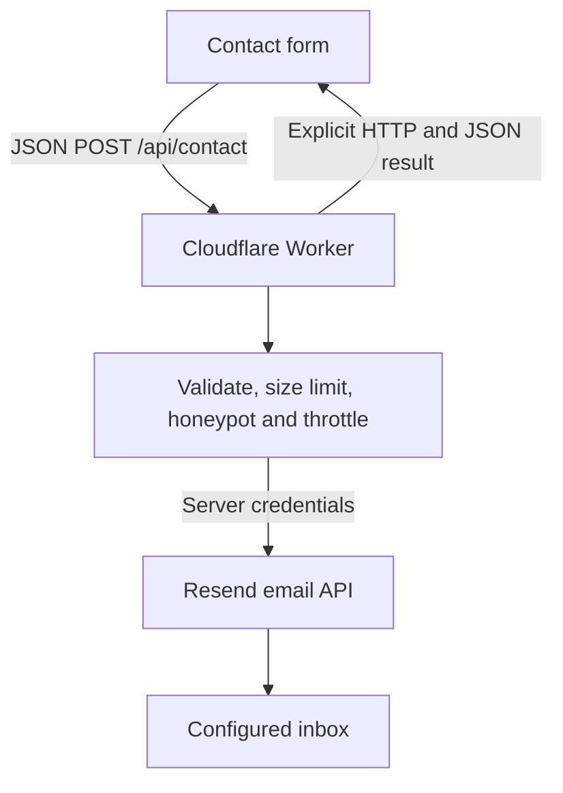

# Fred Loves AI

[Live website](https://fredlovesai.com) · A personal portfolio by Leo Helzberg, an economics student at CU Boulder exploring applied AI and integration.

This project pairs an editorial React interface with a server-side email delivery handler. It demonstrates API boundaries, defensive input handling, asynchronous UI states, and deployment beyond a static export.

## Architecture



- **Frontend:** TypeScript, React, Next-compatible App Router pages, Tailwind CSS. Existing design and editorial content are preserved.
- **Runtime:** Vinext builds the application into a Cloudflare Worker using the Sites build integration. `worker/index.ts` routes `/api/contact` to `server/contact.mjs`; other requests use the framework handler.
- **Delivery:** HTTPS to Resend, rather than SMTP/TCP. The sender and recipient are server configuration; visitors can only set Reply-To. No contact records are stored in an application database.
- **Build output:** `dist/client` and `dist/server`. This is no longer a static `out/` deployment: static hosting alone cannot execute the contact handler.

## Current delivery status

The delivery handler is implemented and its success/failure paths are covered by automated tests with an injected email API. **Production email credentials are not configured yet.** Until configured, valid submissions return HTTP 503 with a visible explanation and LinkedIn fallback. A passing mock test is not evidence of inbox delivery.

To activate real delivery, provision a Resend API key, verify a sender domain, set the three server-side values below, and perform the inbox test. Existing Zoho receiving mail can remain in place; use the provider's exact DNS instructions and preserve existing mail records. Never create a second SPF record at the same hostname.

## Local setup

Use Node.js 22.13 or newer and npm. The checked-in lockfile pins dependencies.

```sh
npm ci
cp .env.example .dev.vars
```

Fill `.dev.vars` locally:

| Variable | Purpose |
| --- | --- |
| `RESEND_API_KEY` | Sending API key; server only |
| `CONTACT_FROM_EMAIL` | Bare sender address on a verified Resend domain |
| `CONTACT_TO_EMAIL` | Inbox that receives contact messages |

No value uses a `NEXT_PUBLIC_` prefix. `.env` and `.dev.vars` files are ignored. Configure the same keys separately in **Sites runtime environment variables**, marking the API key secret. GitHub Actions secrets are not the deployed Worker's runtime configuration.

```sh
npm run dev
```

Open the URL printed by the server (normally http://localhost:5173), scroll to Contact, and send a test using an email address you control. Both local development and a built Worker started with `npm start` use Wrangler local environment configuration (`.dev.vars`).

## Test the form

```sh
npm test
npm run lint
npm run build
```

The test suite exercises the actual handler with Web Request/Response objects and a substituted outbound transport. It covers accepted delivery, recipient/Reply-To, invalid and non-string fields, header injection, malformed JSON, request size limits, cross-origin requests, methods, missing configuration, provider rejection, invalid provider responses, network errors, timeout, and throttle expiration. It sends no email and requires no API key.

Manual end-to-end checks after configuring real credentials:

1. Submit a valid name, email, and message of at least 10 characters. Observe **Sending…**, disabled controls, then an acceptance message and cleared fields.
2. Check the destination inbox and spam folder for the complete message. Reply and confirm the reply is addressed to the visitor. Check the provider's delivery event if the message is missing. API acceptance alone does not prove inbox arrival.
3. Try an invalid email or short message. Browser validation should prevent submission; the server independently rejects bypassed validation.
4. Remove the local key and restart. Submit again: expect an error alert, retained text, and a LinkedIn fallback. Restore the key afterward.
5. Use the browser Network panel's Offline mode and submit. Expect a visible error with the message preserved. Restore connectivity and retry.
6. Repeat on a narrow/mobile screen and with keyboard navigation. Status announcements use `role=status`; errors use `role=alert`.

For a direct API check, replace the origin/port with the server URL and use a fresh UUID for each new message. Reuse the UUID only for an identical retry:

```sh
curl -i http://localhost:5173/api/contact \
  -H 'Content-Type: application/json' \
  -H 'Origin: http://localhost:5173' \
  -H 'Idempotency-Key: bf983733-d55f-4eab-bb44-c9ce31496bc9' \
  --data '{"name":"Local Test","email":"you@example.com","organization":"","message":"Testing my contact form end to end.","website":""}'
```

## API contract and decisions

`POST /api/contact` accepts `name` (1–120 characters), `email` (up to 254), optional `organization` (up to 160), `message` (10–5,000), and empty `website` (honeypot). Text is trimmed before validation. Requires JSON and a UUID v4 `Idempotency-Key` header. Streamed bodies are limited to 24,000 bytes; a forged/missing Content-Length cannot bypass the limit.

| HTTP status | Meaning |
| --- | --- |
| 200 | Provider accepted the email; `{ "ok": true, "message": "…" }` |
| 400 / 413 / 415 | Invalid fields/JSON/key, oversized body, or unsupported media type |
| 403 / 405 | Cross-origin submission or unsupported method |
| 429 | Per-isolate attempt limit; `Retry-After: 60` |
| 503 | Delivery is not configured |
| 502 / 504 | Provider rejection/invalid response or unconfirmed delivery/network timeout |

Every response is JSON with a public `message` and `Cache-Control: no-store`. Provider response bodies, credentials, names, email addresses, and message text are not logged. Operational logs contain only event names and provider HTTP status.

**Why these choices:**

- Server-only credentials and fixed recipients prevent browser key exposure and an arbitrary-recipient email relay.
- Plain-text email avoids rendering visitor-supplied HTML. Single-line identity fields reject line breaks.
- The server waits for a valid provider acceptance ID before returning success. An 8-second provider timeout and 15-second browser timeout bound waiting; failures keep the draft in the form.
- An identical browser retry reuses the provider idempotency key. Editing the message creates a new key. Reloading loses that key; provider deduplication is not a durable application queue or an exactly-once guarantee.
- Honeypot, same-origin browser checks, and a bounded in-memory throttle reduce casual abuse. The five-attempts-per-minute limit uses Cloudflare's IP header and is **per Worker isolate**, not a distributed guarantee. Origin headers are not authentication. For heavier traffic, add managed WAF/rate limiting or a verified CAPTCHA before increasing sending limits.
- No automatic retries after uncertain delivery: the visitor chooses whether to retry, with the same key. Provider acceptance is distinguished from confirmed delivery; bounces require provider delivery events.

## Deployment

Canonical public source: [Fred-Leo/fred-loves-ai](https://github.com/Fred-Leo/fred-loves-ai). Hosting uses the existing public Sites project recorded in `.openai/hosting.json`.

1. Configure the server variables in the existing Sites project's runtime settings. Do not put them in hosting.json or a build artifact.
2. Run tests, lint, and the production build above. CI runs the same checks.
3. Push the reviewed source to GitHub.
4. Synchronize that exact source to the existing Sites source repository using its authenticated source workflow, package the Worker build, save a Site version tied to the pushed source commit, and deploy that version. GitHub CI alone does **not** publish the Site.
5. Check deployment success, then repeat the real inbox test at https://fredlovesai.com. Retain the previous saved version for rollback.

The source workflow is documented by the Sites integration; it supplies repository credentials and builds/packages the exact pushed revision. Reuse the existing project and domain rather than creating a second Site. A saved static deployment will not serve the new API.

## Commit your changes

```sh
git status --short
git diff --check
npm test
npm run lint
npm run build
git add README.md .env.example .gitignore package.json package-lock.json \
  next.config.ts vite.config.ts eslint.config.mjs cloudflare-env.d.ts \
  .openai/hosting.json .github/workflows/ci.yml scripts vendor worker server tests \
  src/components/contact-form.tsx src/app/globals.css src/app/layout.tsx
git diff --cached --stat
git commit -m "Implement contact delivery handler and document runtime architecture"
git push origin main
```

Use a branch and pull request when collaborating. Inspect staged files before committing; never add local credential files. If these changes are already on the remote, pull them instead of repeating the commit. Do not claim real email delivery on a resume until the configured inbox test passes.
